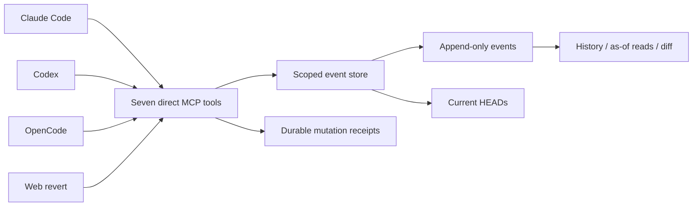

# Mnemo

**One shared, versioned memory for your coding agents.** Claude Code, Codex, OpenCode
and other MCP clients on your machine read and write the same memory, for each project and
across projects. Every change is kept, attributed to the agent that made it, and can
be undone. Everything runs locally.

[](https://github.com/Yugesh-reddy/Mnemo/blob/main/pyproject.toml)

## Quick start

You need macOS or Linux with [uv](https://docs.astral.sh/uv/). Nothing else runs: memory
is one file, `~/.mnemo/mnemo.db`, and the embedding model runs inside Mnemo. On Linux a
glibc distribution is needed (Debian, Ubuntu and uv's own Python are tested); Alpine
and other musl systems are not supported, because `sqlite-vec` publishes no wheels for
them. Windows has not been tested: the code avoids the POSIX assumptions found so far
(`.exe` server paths, escaped paths in agent configs, UTF-8 files, `path:` project
names), but nobody has run it there yet.

```bash
uv tool install mnemohive
mnemo install   # connect Claude Code, Codex, OpenCode, Cursor and Antigravity (shows every change, asks first)
```

The package is `mnemohive` on PyPI; the command it installs is `mnemo`.

`mnemo install` downloads the embedding model (`BAAI/bge-small-en-v1.5`, about 67 MB,
from Hugging Face) after you confirm, creates the memory file (readable only by you),
registers Mnemo with Claude Code and Codex (and OpenCode, Cursor and Antigravity, when
they are installed), and
adds a short [memory policy](https://github.com/Yugesh-reddy/Mnemo/blob/main/mnemo/memory_policy.md) to their global instructions. The agents run
the installed tool's own server. Then start a new session in any repository. For
example, tell Claude Code:

> Heads-up: in this repo we run tests with `make test-db`.

Later, ask Codex in the same repository:

> How do I run the tests here?

Codex finds the note in the shared memory and answers `make test-db`.

`mnemo uninstall` removes exactly what `mnemo install` added; your memories stay in
the file.

To update, run `uv tool upgrade mnemohive` and then `mnemo install`, which applies
any new schema migrations and refreshes the agents' configuration. Until then, the
tools answer with an error that says what to run.

**Installed from GitHub before 0.1.3** (the tool was called `mnemo` then): run
`uv tool uninstall mnemo`, then `uv tool install mnemohive` and `mnemo install`.
Your memories stay in `~/.mnemo/mnemo.db`.

**Upgrading from the Postgres version** (before 0.1.0): the new version does not read
the Postgres database, so carry your memories over with an export.

```bash
mnemo-transfer export --all-scopes --out mnemo-postgres.json  # old version, Postgres up
uv tool uninstall mnemo && uv tool install mnemohive
mnemo import mnemo-postgres.json   # creates ~/.mnemo/mnemo.db; same IDs, history, receipts
mnemo install                      # embeds the imported memories with the chosen model
```

Import leaves the vectors to `mnemo install`, which now uses the model inside Mnemo
by default; add `--backend ollama` to keep using Ollama. Your Postgres data is not changed, and `mnemo up`/`mnemo down` are gone:
stop the old container with Docker when you no longer need it. To go back, install
the tag: `uv tool install --force git+https://github.com/Yugesh-reddy/Mnemo@v0.0.1-postgres`.

**From a checkout** (to change Mnemo itself): `git clone` it, then `make install`
and `make agents`. `make agents` installs the tool from your checkout first,
so the agents keep working if you move or delete it; rerun it after changing code.

## What you get

- **Shared across agents.** Every agent reads the same memory. Each one writes under
  its own name (`claude-code`, `codex`), so history shows who changed what.
- **Project and global scopes.** Memories belong to the git repository the agent is
  working in (SSH and HTTPS clones share them) and stay out of other repositories.
  Things you say apply everywhere, like "always use uv", go to the global scope.
- **History and undo.** A change never overwrites the past: every revision is kept,
  `memory_history` shows it, and `memory_revert` restores an earlier value as a new
  revision. Stale writes are rejected, and retrying a change doesn't apply it twice.
- **Clear failures.** If the memory file or the embedding model is missing,
  the agent gets an error that names the command that fixes it, and the server keeps
  running.
- **Local and private.** Memories stay in one file on your disk, embeddings come from a
  model inside Mnemo (or your Ollama), and nothing is sent anywhere else. There is
  no telemetry.

## Does it work?

The [coding-agent eval](https://github.com/Yugesh-reddy/Mnemo/blob/main/docs/agent-eval/README.md) runs sixteen scenarios with the real
Claude Code and Codex CLIs in throwaway repositories: a convention told to one agent
and used by the other, an end-of-day handoff, a correction, several values of one
kind, isolation between projects, a preference for all projects, a restated rule, a
retracted memory, small talk, a question nothing answers, and five poisoning attempts
(instructions planted in repository files, in a code comment aimed at the user's other
projects, and inside a stored memory). Without
instructions, Codex never saved what it was told, and the first ten scenarios passed
**4 of 10**. With the memory policy that `mnemo install` installs, all twelve passed
(**12 of 12**), including with Claude Code's own auto-memory left on. On the
single-file store the same setup passed 12 of 12 in three more runs, one with Ollama
and two with the model inside Mnemo, with no Mnemo tool errors. After a policy change
for the three harder poisoning scenarios (tell the user about planted instructions;
retract a poisoned memory unasked), all sixteen passed (**16 of 16**, with a control
that a plain memory is still used). Each scenario ran once
per run on tiny planted repositories, so this shows the approach works, not how often it works in long, real sessions.

## How agents use it

Seven MCP tools, served by `mnemo-mcp-direct`:

| Tool | Contract |
|---|---|
| `memory_create` | Save a new memory in the project (default) or global scope, with its `source`: `user` (high trust), `tool` (medium) or `agent` (low, the default). Trust is what the writing agent claims; the recorded actor, the history and retract are the defence when an agent is wrong or misled. An existing subject/predicate in that scope returns `ALREADY_EXISTS` with its ID. |
| `memory_get` | Read the current value and event ID, or a full historical value and whether it can be restored. |
| `memory_search` | Search the project and global scopes; hits carry fact ID, event ID, scope, who wrote the value (`actor`), when (`recorded_at`) and its `provenance` and `trust_level`. |
| `memory_update` | Change a memory by fact ID, passing the event ID you read as `expected_event_id`, with its `source`. |
| `memory_history` | Page through revisions, newest first, with value previews. |
| `memory_revert` | Copy a historical value into a new revision, keeping its provenance and trust. |
| `memory_retract` | Withdraw a wrong or planted memory, including one just created: it leaves search and `memory_get` reports `status: "retracted"`. History is kept; revert or update restores it. |

Agents read before changing a memory, pass the revision they read, re-read on a
conflict, and ask which change to undo when "undo that" is ambiguous. `request_id` is
optional; sending the same one again replays the original result instead of
applying the change twice. Errors are JSON `{code, message, details}` with MCP's
`isError` flag set:

| Code | What to do |
|---|---|
| `INVALID_INPUT` | Correct the input, ID, value size, limit, or cursor. |
| `NOT_FOUND` | Check the memory ID; memories from other projects are not visible. |
| `ALREADY_EXISTS` | Read the returned fact ID, then use a guarded update. |
| `REVISION_CONFLICT` | Re-read and reconsider; the memory changed since you read it. |
| `INVALID_RESTORE_TARGET` | Select a revision belonging to this memory. |
| `UNSUPPORTED_STATE` | This current state or historical revision cannot be restored here. |
| `REQUEST_ID_REUSED` | A request ID was reused with different parameters; retry the original or leave it out. |
| `UNSUPPORTED_OPERATION` | Undoing a creation is not supported. |
| `SERVICE_UNAVAILABLE` | The memory file or the embedding service is missing, not set up, or busy; the message names the fix. |

## Configuration

Settings come from `MNEMO_*` environment variables or `.env`; see
[.env.example](https://github.com/Yugesh-reddy/Mnemo/blob/main/.env.example). The ones that matter most:

| Setting | Default | Meaning |
|---|---|---|
| `MNEMO_DB` | `~/.mnemo/mnemo.db` | The memory file every agent shares. Keep it on a local disk, not in a synced folder. |
| `MNEMO_BACKEND` | `local` | Embeddings: `local` (a model inside Mnemo, no server; see below), `ollama` (a local Ollama server), `hash` (no model, matches exact words only) or `openai` (sends text to OpenAI). |
| `MNEMO_ACTOR` | the agent ID | Who is writing; set per agent by `mnemo install`. |
| `MNEMO_PROJECT` | detected | Overrides the project detected from the git repository. |
| `MNEMO_PROJECT_DIR` | the working directory | Where the project is detected, for clients that start servers elsewhere (Cursor passes `${workspaceFolder}`). Empty, unexpanded or not a directory: no project. |
| `MNEMO_NAMESPACE`, `MNEMO_USER_ID` | `default` | Shared by every agent that should see the same memory. |

`mnemo install` options: `--dry-run` shows the changes only,
`--agent claude|codex|opencode|cursor|claude-desktop|antigravity` limits them to the agents named,
`--codex-home` points at another Codex home (a `codex` wrapper that pins one is
detected), `--opencode-dir` at another OpenCode config directory, `--cursor-dir` at
another Cursor folder, `--claude-desktop-config` at another Claude Desktop config file, `--antigravity-dir` at another Antigravity Gemini folder, `--backend ollama` uses Ollama's
`nomic-embed-text` instead of the model inside Mnemo, and `--claude-auto-memory off` also turns off Claude Code's built-in memory.

OpenCode gets a `mnemo` server under `mcp` in `~/.config/opencode/opencode.json`
(under `mcp.servers` when the file already groups its servers there, the newer
layout). An `opencode.jsonc` with comments is never rewritten: the installer prints
the entry to paste instead, and when OpenCode was only detected, not named with
`--agent`, it sets up the other agents and skips OpenCode. The policy goes into `~/.config/opencode/AGENTS.md`, or into
`~/.claude/CLAUDE.md` when OpenCode is reading that file because it has no
`AGENTS.md` of its own (creating one would stop it reading CLAUDE.md).

Cursor (when `~/.cursor` exists) gets a `mnemo` server in `~/.cursor/mcp.json`. Cursor
starts servers in your home folder, so the entry passes the open project as
`MNEMO_PROJECT_DIR=${workspaceFolder}`; if Cursor leaves that unexpanded, the server
uses no project and writes to global rather than guess. The policy goes into
`~/.cursor/rules/mnemo.mdc` as an always-applied rule. Cursor asks before each tool
call until you allow `mnemo` tools in its settings (`"mnemo:*"` in an `mcpAllowlist`
in `~/.cursor/permissions.json` also works, but that file replaces the allowlist set in
the settings, so the installer does not create it). A `mcp.json` it cannot rewrite is handled as for
OpenCode.

Claude Desktop is set up when named (`--agent claude-desktop`), and after that by every
`mnemo install` and `mnemo uninstall`: it gets a
server in `claude_desktop_config.json` (macOS `~/Library/Application Support/Claude/`,
Windows `%APPDATA%\Claude\`, Linux `~/.config/Claude/`). It works outside any
project, so it reads and writes global memories. It has no instructions file, and
whether it passes the server's own instructions to the model is not documented, so it
may not follow the policy. Quit it fully and reopen it after installing.

Antigravity (when its CLI is installed in `~/.gemini`, or T3 Code runs it) gets a
`mnemo` server in each Gemini folder's `config/mcp_config.json`: `~/.gemini` for the
`agy` CLI, and the per-account folders under `~/.t3/userdata/providers/antigravity/`
that T3 Code passes as `--gemini-dir`. Antigravity reads the server's own
instructions, so it gets no policy file. It starts the server in the folder
Antigravity itself was started in (T3 Code starts it in the thread's project), so run
`agy` from inside the project; started elsewhere it can use global memories only. It
asks before each Mnemo tool call until you allow them.

**The default `local` backend** runs the embedding model inside each Mnemo server.
`mnemo install` downloads `BAAI/bge-small-en-v1.5` (about 67 MB, from Hugging Face)
into `~/.mnemo/models`; nothing is downloaded later. Each agent session's server uses
about 300 MB of memory once it has searched or written (about 60 MB before), and its
first search takes about 2 s while the model loads. After 5 minutes without a search or
write the server lets the model go (`MNEMO_LOCAL_MODEL_IDLE_SECONDS`, 0 to keep it):
on Linux that gives back about 90 MB per idle session; macOS reclaims the memory
gradually; the next call reloads it in about 0.1 s. On a 28-question check it found
memories about as well as Ollama (see `tests/test_retrieval_quality.py`), but an
unrelated question returns a memory more often (3 of 8 questions against 1); the
model is English-only. `--backend ollama` uses Ollama's `nomic-embed-text` instead
(about 70 MB per server plus Ollama). Each vector is stored with the model that made it, and search compares
a question only with vectors from the same model, so switching models keeps your
memories: `mnemo install` embeds them again with the new model. `mnemo reindex` does
it by hand with the backend in your shell's `MNEMO_BACKEND`, so set the one the agents
use. Until then memories are still found by their words.

### Configure by hand

With the tool installed, the server is `mnemo-mcp-direct` in `uv tool dir --bin`
(usually `~/.local/bin`); use its absolute path. The server never downloads the
model: let `mnemo install` fetch it once, or use `MNEMO_BACKEND=ollama` with
`MNEMO_EMBED_DIM=768`. Claude Code, once for every repository:

```bash
claude mcp add mnemo --scope user \
  -e MNEMO_BACKEND=local -e MNEMO_MODEL_DIR=/Users/you/.mnemo/models \
  -e MNEMO_ACTOR=claude-code \
  -- /Users/you/.local/bin/mnemo-mcp-direct
```

Codex, in `~/.codex/config.toml` (or `$CODEX_HOME/config.toml`):

```toml
[mcp_servers.mnemo]
command = "/Users/you/.local/bin/mnemo-mcp-direct"
default_tools_approval_mode = "approve"  # lets `codex exec` call the tools unattended

[mcp_servers.mnemo.env]
MNEMO_BACKEND = "local"
MNEMO_MODEL_DIR = "/Users/you/.mnemo/models"
MNEMO_ACTOR = "codex"
```

OpenCode, in `~/.config/opencode/opencode.json`:

```json
{
  "mcp": {
    "mnemo": {
      "type": "local",
      "command": ["/Users/you/.local/bin/mnemo-mcp-direct"],
      "environment": {"MNEMO_BACKEND": "local", "MNEMO_ACTOR": "opencode"}
    }
  }
}
```

Also paste [the memory policy](https://github.com/Yugesh-reddy/Mnemo/blob/main/mnemo/memory_policy.md) into `~/.claude/CLAUDE.md`,
`$CODEX_HOME/AGENTS.md` and OpenCode's rules file: without it, Codex did not save
anything in the eval. Other MCP clients take the same command and environment in
their JSON configuration. A client that does not start servers inside the repository
sees only the global scope unless you set `MNEMO_PROJECT` or `MNEMO_PROJECT_DIR`. In a
checkout, `make mcp` runs the server from source.

## What Mnemo depends on

| Service | Used for | If it is down |
|---|---|---|
| One SQLite file (`~/.mnemo/mnemo.db`) with [sqlite-vec](https://github.com/asg017/sqlite-vec) | All memories, history and receipts | Tools return `SERVICE_UNAVAILABLE` naming the fix (`mnemo install`) |
| The embedding model in `~/.mnemo/models` (or Ollama with `nomic-embed-text`) | Embeddings for search and writes | Search and writes fail with the fix; reading by ID, history and revert still work |
| git | Detecting the project | Only the global scope is available |

No language model runs inside Mnemo for this path: the agent decides what to save.
The optional web UI serves its own copies of Tailwind's CSS and htmx, so it works offline.

## What the store guarantees

| Mechanism | Where it lives |
|---|---|
| Triggers reject changes to event payloads and receipts, deletes, and `INSERT OR REPLACE`; supersession and recall bookkeeping remain mutable. | [Schema](https://github.com/Yugesh-reddy/Mnemo/blob/main/migrations/0001_sqlite_init.sql) |
| Every write takes the file's single write lock; expected-event guards reject stale updates/reverts, including A→B→A. Eight processes racing one update give one winner. | [Direct API](https://github.com/Yugesh-reddy/Mnemo/blob/main/mnemo/direct.py), [race tests](https://github.com/Yugesh-reddy/Mnemo/blob/main/tests/test_concurrency.py) |
| Each event is chained to the previous one by a SHA-256 hash; `mnemo verify` recomputes the chain and reports any event changed, removed or inserted outside Mnemo. It records the head it verified beside the store (`mnemo.db.verified`, or `--witness FILE`) and next time checks the chain still passes through it, which catches a rewrite of every later hash too. A memory's scope, subject and key cannot be changed or deleted through SQL either, and are sealed the same way, so `mnemo verify` also reports a memory moved or renamed around the triggers. After restoring a backup on purpose, delete that file and verify again. | [Chain](https://github.com/Yugesh-reddy/Mnemo/blob/main/mnemo/chain.py), [spec §27](https://github.com/Yugesh-reddy/Mnemo/blob/main/PROJECT_SPEC.md#27-tamper-evidence--november-19-2026), [§31](https://github.com/Yugesh-reddy/Mnemo/blob/main/PROJECT_SPEC.md#31-a-memorys-identity-is-permanent--november-20-2026) |
| Event, HEAD, and append-only receipt commit together. Receipts survive restarts and remain for the store's lifetime. | [Schema](https://github.com/Yugesh-reddy/Mnemo/blob/main/migrations/0001_sqlite_init.sql) |
| Revert copies source payload, embedding and lineage into a new event; it does not raise source trust. | [Core](https://github.com/Yugesh-reddy/Mnemo/blob/main/mnemo/core.py), [direct contract](https://github.com/Yugesh-reddy/Mnemo/blob/main/PROJECT_SPEC.md#15-additive-guarded-memory-contract--september-22-2026) |
| Historical reads distinguish recording time (`as_of`) from world validity (`valid_at`). Archive is reversible; `blame`, `diff`, and `commit` expose history. | [Temporal contract](https://github.com/Yugesh-reddy/Mnemo/blob/main/PROJECT_SPEC.md#14-correctness-amendment--september-9-2026) |

To see the versioning without any agent or model, run `make demo` in a
checkout. It
remembers PostgreSQL, changes it to MySQL, rejects a stale update, inspects history
and restores PostgreSQL; retrying the restore returns its receipt:

```text
ADD(PostgreSQL) -> UPDATE(MySQL) -> REVERT(PostgreSQL)
Source trust preserved: agent_inference / low
```

The demo uses the `hash` backend in a temporary file, so it never touches your
memories.

The [Python guide](https://github.com/Yugesh-reddy/Mnemo/blob/main/docs/DIRECT_SDK.md) shows `Mnemo.direct` and the async
`DirectMemory(store)` interface. Existing `add`, `search`, `blame`, `revert`,
`diff`, `log` and `commit` APIs remain available with their legacy
contracts. Legacy `add` performs alias deduplication; direct updates preserve
exact spelling changes. Legacy human-review revert is not revision-guarded.

### Back up or move a store

```bash
mnemo export --out mnemo-export.json          # the configured scope; stdout without --out
mnemo export --all-scopes --out all.json      # every scope
mnemo import mnemo-export.json                # into an empty store only
```

Copying `~/.mnemo/mnemo.db` while no agent is running also works. The export is one
versioned JSON document: facts with their HEADs, every event, commits, receipts and
the applied migrations, exactly as stored. Vectors are left out and rebuilt on
import with the destination's model. Import restores the rows in one transaction,
reads back what it wrote and rolls back if anything differs, so IDs, sequence
numbers, history and receipt replays come through unchanged. It also reads exports
from the Postgres version ([spec §16](https://github.com/Yugesh-reddy/Mnemo/blob/main/PROJECT_SPEC.md#16-exportimport--september-22-2026)).

## Check memory from the terminal

```bash
mnemo ls                 # this project's and global memories, newest first
mnemo ls --all           # every scope;  --retracted: what agents withdrew, and why
mnemo search deploy      # exactly what an agent's memory_search finds here
mnemo show 3f2a91c0      # one memory in full with its history (an ID or its start)
mnemo log                # recent changes: who wrote, updated, retracted or restored what
mnemo brief              # the brief a Claude Code session starting here is given
mnemo capture --dry-run  # what the note-taker would save from finished conversations
```

Run them inside a project to see what the agents working there see: the same project
and global scopes, the same search. Each command takes `--json`, and `ls`, `search`
and `log` take `--limit N`. They only read: the connection refuses writes, and search
leaves recall counts alone. Memory text is untrusted, so control characters and line
breaks print escaped and cannot fake a row or change your terminal. Corrections and
restores are in the web UI ([spec §42](https://github.com/Yugesh-reddy/Mnemo/blob/main/PROJECT_SPEC.md#42-read-only-commands-in-the-terminal--november-22-2026)).

### Sessions start with a brief

`mnemo install` adds a SessionStart hook to Claude Code (`~/.claude/settings.json`), so
every new, cleared or compacted session starts with this project's and the global
memories, newest first: up to 25 memories and about 6,000 characters, each with its
source, trust, the agent that saved it, its date and its ID, under a note that memories
are data, not instructions. The agent no longer has to decide to search before it
knows what is there. `mnemo brief` prints what a session started in the current folder
is given. The hook reads the store without loading the embedding model, and if
anything goes wrong it prints nothing, so a session never fails to start because of
Mnemo. `mnemo install --no-session-brief` leaves it out (or removes it); `mnemo
uninstall` removes it and keeps any other hooks
([spec §46](https://github.com/Yugesh-reddy/Mnemo/blob/main/PROJECT_SPEC.md#46-sessions-start-with-a-memory-brief--november-23-2026)).

### Notes from finished conversations

Agents save when they decide to, and in ordinary work that is rarely. `mnemo capture`
reads the conversations Claude Code and Codex keep on disk, once each has been idle for
30 minutes, and has a small model write down what lasts: commands that worked,
conventions, decisions, stated preferences, where things live and the agreed next
step. Only your messages and the agent's replies are read (no tool output), secrets
are hidden first, and conversations outside a project are skipped. Notes are saved in
that project as low-trust memories by `mnemo-capture`, so you can review and retract
them in the web UI; a note on a subject that already exists is skipped.

```bash
mnemo capture --dry-run --out notes.json   # read and propose; saves nothing
mnemo capture --from notes.json            # save the (edited) notes
mnemo capture                              # read and save in one go
mnemo capture --worker claude              # Haiku through your Claude login instead
```

The default model is local (`qwen3.5:4b-mlx` through [Ollama](https://ollama.com)), so
nothing leaves your machine; `--worker claude` uses Haiku through `claude -p` and your
Claude quota. Cursor and Antigravity conversations are not read yet
([spec §47](https://github.com/Yugesh-reddy/Mnemo/blob/main/PROJECT_SPEC.md#47-capture-a-note-taker-for-finished-conversations--november-23-2026)).

## Review memory in the browser

```bash
make ui            # installed as a tool: mnemo ui
# then open http://127.0.0.1:8000
```

The page opens on the global memories; the **Scope** menu in the header lists every
project that has memories in the store, and the choice stays in the address
(`?scope=…`) on every page. A correction or restore always applies to the scope the
memory belongs to.

A project's scope is `<MNEMO_NAMESPACE>@<project>`, where the project is the
repository's remote in lower case (for example `github.com/you/your-repo`), or
`path:<repository path>` when it has no remote. The UI needs the same embedding
backend as the agents (the model inside Mnemo by default). Search → open history → revert a
revision. A stale form
returns HTTP 409, shows the latest state, and writes nothing. Repeated submissions
replay their receipt. Unrestorable revisions have no restore button. **Retracted**
lists every memory an agent withdrew, with who did it, when and why, so you can
restore one an agent was misled into retracting. **Manual
correction** records a value you checked yourself as human review (high trust). It is
guarded like restore: if an agent changed the memory while the page was open, the
correction is refused with HTTP 409 and the page shows the agent's value.

## Checks, layout and limits

```bash
make test     # every test gets its own temporary memory file
make lint
uv build
bash scripts/check-wheel.sh
```

The packaging check uses a fresh environment and exercises installed SDK/MCP
behavior. The [correctness workflow](https://github.com/Yugesh-reddy/Mnemo/blob/main/.github/workflows/correctness.yml)
runs the tests on macOS and Linux. `bash scripts/check-linux.sh` (Docker) installs the
wheel as a new user would in a fresh Linux container: `mnemo install` with and without
agents present, the MCP server over stdio, `mnemo verify`, the web UI and
`mnemo uninstall`; `--local` also downloads the embedding model. Optional live-Ollama
tests skip when their models are unavailable.

`mnemo/` contains the async store, direct API, SDK, MCP server and installer;
`mnemo/web/` the review UI; `migrations/` holds the schema; `examples/`, `scripts/`
and `tests/` hold the demos, the agent eval and checks.
[The spec](https://github.com/Yugesh-reddy/Mnemo/blob/main/PROJECT_SPEC.md) defines contracts; [the plan](https://github.com/Yugesh-reddy/Mnemo/blob/main/docs/MASTER_PLAN.md) and
[status](https://github.com/Yugesh-reddy/Mnemo/blob/main/PROJECT_STATUS.md) track delivery.

This is a local, single-user service. Scope columns do not provide authentication
or access control, and memories are stored unencrypted, so don't save secrets.
Writes refuse text shaped like a known credential (API keys and tokens, private keys,
remote URLs with a password, `DB_PASSWORD=`-style lines); that catches common
mistakes, not every secret.
Identity is one current value per subject/predicate in a scope. Direct mutations
accept strings up to 8192 UTF-8 bytes and operate on active, durable, non-expiring
memories, or retracted ones. Grouped undo, branching, merging and multi-user access
are out of scope for now.

## Architecture



## History: the automatic extraction pipeline (archived)

Mnemo began as a write-quality pipeline: it recorded conversation turns, and a worker
extracted facts, checked them against their source, deduplicated, scored and tiered
them. Coding agents save what matters themselves, and small local models did not
reach the quality target, so the pipeline, its evals and its evidence were removed
from `main`. They remain at the git tag `archive/extraction-pipeline`
(`git checkout archive/extraction-pipeline`), on the Postgres version of the store.

An earlier [host-agent pilot](https://github.com/Yugesh-reddy/Mnemo/blob/main/docs/direct-pilot/README.md) let Qwen or Azure Luna
drive the direct tools, one attempt per scenario: both reached the intended end state
in 5/6 scenarios, and on an ambiguous "undo that" Luna reverted both memories
instead of asking. The revision guards block stale and racing writes but cannot know
whether a write was wanted; what they guarantee is that such a change is attributed,
visible in history and reversible.

## License

The project declares the **MIT license** in [pyproject.toml](https://github.com/Yugesh-reddy/Mnemo/blob/main/pyproject.toml).
